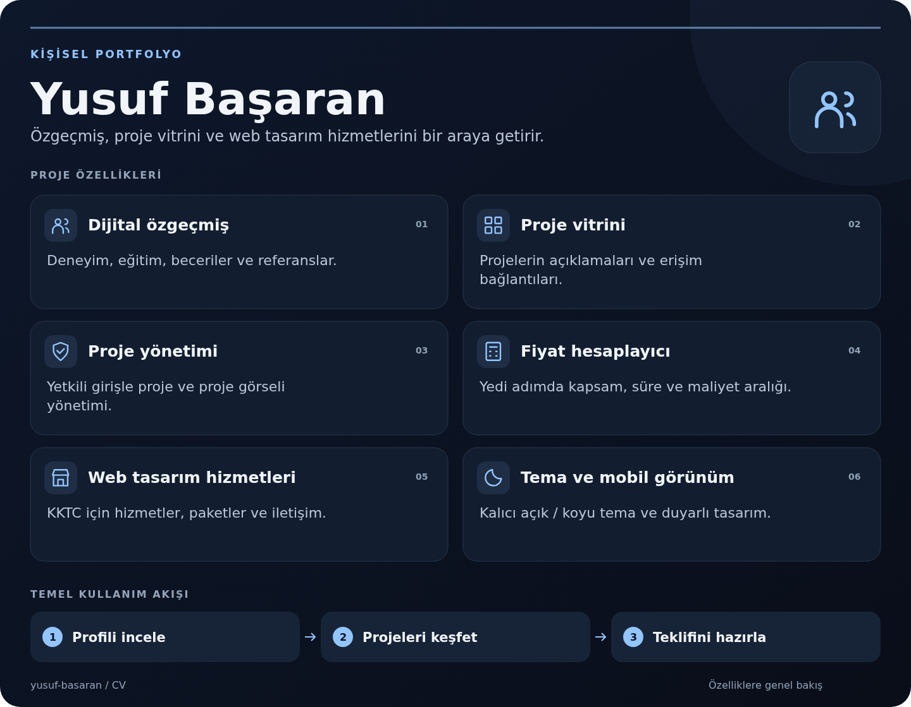

# Yusuf Başaran — Kişisel Portfolyo

Özgeçmiş, proje vitrini ve KKTC için web tasarım hizmetlerini sunan kişisel site.

[Canlı site](https://www.yusufbasaran.dev/)

<!-- project-overview:start -->
## Projeye genel bakış



[Görseli büyük aç](docs/images/project-overview.png) · [SVG kaynağı](docs/images/project-overview.svg)

<details>
<summary>Görseldeki özellikler ve ilgili kaynaklar</summary>

- **[Dijital özgeçmiş](index.html)** — Deneyim, eğitim, beceriler ve referanslar.
- **[Proje vitrini](js/site.js)** — Projelerin açıklamaları ve erişim bağlantıları.
- **[Proje yönetimi](js/site.js)** — Yetkili girişle proje ve proje görseli yönetimi.
- **[Fiyat hesaplayıcı](HESAPLAYICI-KURULUM.md)** — Yedi adımda kapsam, süre ve maliyet aralığı.
- **[Web tasarım hizmetleri](kktc-web-tasarim/index.html)** — KKTC için hizmetler, paketler ve iletişim.
- **[Tema ve mobil görünüm](css/site.css)** — Kalıcı açık / koyu tema ve duyarlı tasarım.

</details>
<!-- project-overview:end -->

## Sayfalar

- `index.html`: özgeçmiş, deneyim, eğitim, beceriler ve proje vitrini.
- `kktc-web-tasarim/`: web tasarım hizmetleri ve paketler.
- `fiyat-hesaplayici/`: kapsam, fiyat aralığı, süre ve teklif adımları.
- `js/` ve `css/`: arayüz kaynakları; yetkili proje yönetimi ve tema desteği.

## Yerel derleme

```sh
npm ci
npm run build
python -m http.server 8000 --directory public
```

Derleme `public/` klasörünü üretir; Vercel bu klasörü yayınlar. Üretilmiş `.min` dosyaları yerine kaynak dosyalar düzenlenmelidir.

## Rehberler

- [Fiyat hesaplayıcının işleyişi](HESAPLAYICI-KURULUM.md)
- [SEO kurulumu](SEO-KURULUM.md)
- [Yayın ve Search Console kontrolleri](YAYIN-TESHIS-VE-SEARCH-CONSOLE.md)
